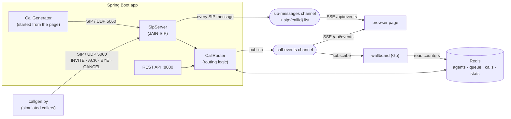

# SIP Call Router

A mini contact-center call router (ACD). Customers call in over **SIP**, a **Java / Spring Boot** service
routes each call to the longest-idle agent with the right skill (language, product), and calls queue in
**Redis** when everyone suitable is busy.
A **Python** call generator simulates callers, and a **Go** wallboard shows the live numbers.

Signaling only: no audio (RTP), which keeps the project small while exercising the real SIP call flow.

## How it works



The user part of the dialed URI picks the skill, the way a dialed number does in a real ACD:
`sip:billing@router` waits for an agent with the `billing` skill; `sip:support@router` (or any name that is not
a skill) is a general call that any agent can take. The demo agents are alice `[en, billing]`, bob `[en]` and
carol `[de, billing]` (`callrouter.agents` in `application.yml`).

| Situation | What the caller gets |
|---|---|
| An agent with the skill is free | `100 Trying` → `180 Ringing` → `200 OK` with `X-Agent-Id` |
| All agents with the skill busy | `182 Queued` with `X-Queue-Position`, then `180` + `200 OK` when one frees up |
| That skill's queue full (`max-queue-size`) | `486 Busy Here` |
| Caller hangs up while queued | `CANCEL` → `200 OK` + `487 Request Terminated` |
| Call ends | `BYE` → `200 OK`; the agent goes back to its free pools and takes the longest-waiting call it can handle |

### Redis data model

| Key | Type | Purpose |
|---|---|---|
| `agents:all` | SET | every agent id |
| `skills` | SET | every skill some agent has |
| `agents:available` | ZSET | all free agents scored by idle-since time. `ZPOPMIN` = longest-idle agent |
| `agents:available:{skill}` | ZSET | free agents with that skill, same scores |
| `agent:{id}` | HASH | `status`, `currentCallId`, `skills` |
| `queue:calls` | LIST | general calls waiting, FIFO (`RPUSH` / `LPOP`) |
| `queue:calls:{skill}` | LIST | calls waiting for that skill, FIFO |
| `calls:active` | SET | connected calls |
| `call:{callId}` | HASH | from, to, skill, state, agentId, wait time; gets a 1h TTL once finished |
| `stats` | HASH | counters via `HINCRBY`, plus `waitMsTotal` (average wait = `waitMsTotal / connected`) |
| `call-events` | PUB/SUB | JSON event per call state change |
| `sip:{callId}` | LIST | every SIP message of the call (direction, first line, raw text) as JSON; 1h TTL |
| `sip-messages` | PUB/SUB | the same JSON, one message per SIP packet, for the browser's ladder diagrams |

## Run it

Requirements: Java 21 (`JAVA_HOME` must point at it), Docker (for Redis), Python 3.10+.
Maven is optional: the Maven wrapper (`./mvnw`, or `mvnw.cmd` on Windows) downloads it.

```bash
docker compose up -d redis          # Redis on :6379
./mvnw spring-boot:run              # SIP on udp/5060, REST on :8080
```

Or run everything in Docker (no Java needed): `docker compose --profile full up -d --build`. SIP over UDP works
through the port mapping because `callgen.py` sends `rport` (see the comment in `docker-compose.yml`). Real SIP
phones behind NAT may need the same.

In a second terminal, place some calls (3 agents are seeded: alice, bob, carol; queue size 5):

```bash
python3 simulator/callgen.py --calls 10 --talk 3 8 --patience 15
```

Or a mix of skills (each caller dials one at random; `--seed` makes the run repeatable):

```bash
python3 simulator/callgen.py --calls 12 --talk 4 7 --interval 0.4 --skills en de billing support --seed 7
```

In a third terminal, the live wallboard (built and run in Docker, so Go is not needed):

```bash
docker compose run --rm wallboard
```

It shows calls waiting (in total and per queue), calls active, free agents, average wait, each agent's status
and the latest events.
It only subscribes to `call-events` and reads Redis; it never calls the Java service.

Or open **http://localhost:8080/** for the browser view. It has:

- **Call generator**: a form that starts simulated callers inside the app (`POST /api/simulator/calls`). They are
  real SIP clients on virtual threads sending UDP to port 5060, so they go through exactly the same path as
  `callgen.py` (a Java twin of it, `simulator/SimulatedCaller.java`).
- **SIP signaling**: a ladder diagram per call (caller ⇄ router) that grows live as messages are sent and received,
  with queue positions and agent names on the arrows. Click an arrow to see the full SIP message. It shows what
  `SipServer` sees, so the ACK for a `486`/`487` is missing: JAIN-SIP absorbs it inside the INVITE transaction.
- **Queues**: every queue with its fill level against `max-queue-size` and the waiting callers in order with live
  wait times, plus the connected calls (agent, wait, talk time) and each agent's status.

The page listens to `GET /api/events`, a Server-Sent Events stream with two event types: `call` (every
`call-events` message) and `sip` (every `sip-messages` message). `curl -N localhost:8080/api/events` shows the raw
stream; `curl -s localhost:8080/api/calls/{callId}/sip` returns one call's SIP history.

## Demo script

```bash
redis-cli MONITOR                    # watch every Redis command live
redis-cli SUBSCRIBE call-events      # or watch the event stream

curl -s localhost:8080/api/agents | jq
curl -s localhost:8080/api/queue | jq
curl -s localhost:8080/api/calls/active | jq
curl -s localhost:8080/api/stats | jq

# take an agent offline / bring one back (picks up the next queued call immediately)
curl -X POST localhost:8080/api/agents/bob/status -H 'Content-Type: application/json' -d '{"status":"OFFLINE"}'
curl -X POST localhost:8080/api/agents/bob/status -H 'Content-Type: application/json' -d '{"status":"AVAILABLE"}'

# add a new German-speaking agent and bring them online (takes a waiting "de" call right away)
curl -X POST "localhost:8080/api/agents/dave?skills=de"
curl -X POST localhost:8080/api/agents/dave/status -H 'Content-Type: application/json' -d '{"status":"AVAILABLE"}'
```

## Project layout

```
src/main/java/io/github/atelci/callrouter/
  sip/SipServer.java          SIP UAS: maps SIP requests to routing calls and decisions to SIP responses
  call/CallRouter.java        routing logic (skill -> connect / queue / reject; drain queues oldest first)
  agent/AgentService.java     agent state and skill pools in Redis
  sip/SipTrace.java           records every SIP message (Redis list + sip-messages channel) for the UI diagrams
  api/                        REST endpoints, plus EventStreamController (SSE /api/events)
  simulator/                  CallGenerator + SimulatedCaller: SIP callers started from the browser page
  config/                     properties, Redis pub/sub listener
src/main/resources/redis/     claim-agent.lua: claims an agent from every pool at once (and pops a queued call)
src/main/resources/static/    index.html: call generator, live queues, SIP ladder diagrams (plain JS, no build step)
simulator/callgen.py          SIP caller simulator (standard library only)
wallboard/main.go             Go terminal wallboard fed by the call-events channel (go-redis)
```

## Design notes

- **Routing is SIP-agnostic.** `CallRouter` talks to the signaling layer through the `CallSignaling` interface,
  so it can be tested with a fake and the SIP stack could be swapped.
- **State in Redis, transactions in memory.** Open SIP INVITE transactions are live protocol objects, so they
  stay in the JVM; everything about the call itself is in Redis.
- **Skills are just more pools.** A free agent is in the all-agents ZSET and in one ZSET per skill, all with the
  same idle-since score, so "longest-idle agent who speaks German" is a `ZPOPMIN` on `agents:available:de`. The
  catch is that a claimed agent must leave all of its pools at once, or a billing call could claim the same
  agent a moment later. That is why claiming is a Lua script.
- **Claiming is atomic.** "Pop the oldest call + claim the longest-idle agent + take it out of every pool + mark
  it busy" runs as one Redis Lua script (`src/main/resources/redis/claim-agent.lua`); a new call uses the same
  script without the queue part. With separate commands, a second instance could take the last agent in between:
  the popped call would then have to be pushed back (losing its place, or lost entirely if the instance crashed).
- **Fair across queues.** When an agent frees up, the router tries the queues in order of how long their first
  caller has waited, so a multi-skilled agent takes the longest-waiting call it can actually handle.
- **Still not fully multi-instance.** The new-call path (claim an agent, else check the queue size and enqueue)
  is several commands, so router methods stay `synchronized`. Two instances could briefly over-fill the queue
  by one. The fix is the same idea (one more script), plus sticky SIP routing so a call's BYE and CANCEL reach
  the instance holding its INVITE transaction.

## Built with AI assistance

<!-- Fill this in as you go: which tools, what you prompted, what you had to fix by hand. -->

- Scaffolded with Claude (project structure, SIP handler, Redis model, simulator)
- Continued in Claude Code: first `mvn verify` and the end-to-end run with `callgen.py`.
  The scaffold compiled and ran on the first try; no Java changes were needed. Things that came up:
  - The machine's default `java` was 1.8, so the build needs `JAVA_HOME` pointing at a JDK 21.
  - Added the Maven wrapper (`mvnw`, `mvnw.cmd`).
  - A 10-caller run against 3 agents and queue size 5 gave 3 connected right away, 5 queued (FIFO) and then
    connected as agents freed up, and 2 rejected with 486. A short `--patience` run checked CANCEL -> 487.
- Integration tests for `CallRouter` (`CallRouterTest`): real Redis via Testcontainers (`redis:7-alpine`) and a
  fake `CallSignaling`, wired by hand without a Spring context so the SIP stack never binds UDP 5060. Covers
  longest-idle agent first, FIFO queue, queue full -> rejected, BYE frees the agent and drains the queue, CANCEL
  removes a queued call. Fixed by hand: the Testcontainers version Spring Boot 3.5.6 manages (1.21.3) talks
  Docker API 1.32, which Docker Engine 29 refuses ("Could not find a valid Docker environment"); pinning
  `testcontainers.version` to 1.21.4 fixed it. The tests passed on the first run after that.
- Atomic queue draining: `CallRouter.drainQueue()` now calls `claim-next-call.lua` instead of separate
  `LPOP` + `ZPOPMIN` (+ push back on failure). Three new tests cover drain order, an empty queue, and two router
  instances draining one queue from 8 threads (every call gets exactly one agent, no agent is used twice). The
  `callgen.py` demo gives the same results as before. No fixes by hand were needed.
- Go wallboard (`wallboard/`): subscribes to `call-events` and redraws from Redis on every event and once a
  second. Go was not installed on the dev machine, so it is built in the `golang:1.24-alpine` image and run via a
  `wallboard` compose profile. Added a `waitMsTotal` counter to `stats` so the average wait comes from Redis rather
  than from whatever events the wallboard happened to see. Checked against a live run: the wallboard's average wait
  (3.2s) matched `callgen.py`'s summary. One change made after watching it: the counters row was labelled "Today"
  but `stats` is all-time, so it now says "Totals".
- Checked `docker compose --profile full up --build` with SIP over UDP (Docker Desktop on Windows): the full
  `callgen.py` run (connect, queue, 486, BYE drain) and the CANCEL -> 487 path behave the same as the app run via
  Maven, and the container log has no errors or warnings. No code changes were needed. Added a `.dockerignore`
  so the build context no longer ships `target/` (36 MB) and `.git`. One gotcha: after a container restart, wait
  for `SIP server listening` in the logs before calling, or the first INVITEs go nowhere.
- SSE endpoint `/api/events` (`EventStreamController`, Spring MVC `SseEmitter`, no new dependency): the existing
  Redis listener container forwards each `call-events` message to every open stream, so a browser on any instance
  sees all instances' events. `index.html` at `/` shows live counters (from `/api/stats`) and recent events.
  Checked with `curl -N` (6 events for 2 calls) and in a browser during a 10-call run, including the page
  reconnecting on its own after an app restart. Three things fixed after trying it:
  - the event columns did not line up (HTML collapses the padding spaces), so the list now uses `white-space: pre`;
  - with no calls running, an opened page sat at "connecting": nothing was written until the first event, so the
    response headers were never flushed. The endpoint now sends an SSE comment (`:connected`) right away;
  - reloading the page while events flowed logged an ERROR stack trace (Tomcat reporting the closed connection).
    A small `@ExceptionHandler` in the controller treats a disconnected browser as normal.
- Skills-based routing: the dialed SIP user picks the skill; one free-agent ZSET and one queue per skill;
  `claim-agent.lua` replaces `claim-next-call.lua` and takes a claimed agent out of all its pools. `callgen.py`
  got `--skills` and `--seed`, the REST API, the wallboard and the browser page show per-queue waiting counts, and
  `POST /api/agents/{id}?skills=...` registers an agent with skills. Six new tests (14 in total): the skill beats
  idle time, a skill call waits while other agents stay free, an unknown skill is general, a claimed agent leaves
  every pool, a freed agent takes the longest-waiting call it can handle, CANCEL from a skill queue. Checked end to
  end with a 12-caller mixed run: every call reached an agent with its skill. Fixed by hand: one of the new tests
  was wrong (it expected a call for a not-yet-known skill to queue, but the router correctly treats it as general
  and connects it), so it was split into two clearer tests. Re-checked in Docker afterwards
  (`docker compose --profile full up -d --build`): default, mixed-skills and CANCEL runs all behave the same.
- UI upgrade: call generator, live SIP ladder diagrams and queue view on the browser page. Asked for the three
  features; Claude Code chose the design: the SIP diagrams come from a `SipTrace` hook in `SipServer` (every
  received request and sent response goes to a Redis list per call and a `sip-messages` channel, forwarded over the
  existing SSE stream), so `callgen.py` traffic and traffic from any other instance shows up too. The generator is a
  Java port of `callgen.py` on virtual threads rather than the page spawning Python, so it works in the Docker
  image (no Python there). Checked in Docker and with `callgen.py`: connect, queue and drain, `486` and
  CANCEL → `487` all draw correctly, and a page opened mid-call loads the earlier messages from Redis.
  Nothing needed fixing by hand. One thing found while testing: the caller's ACK for a `486`/`487` never shows,
  because JAIN-SIP absorbs it in the INVITE transaction; that is documented rather than worked around.

## Next steps

- Media: SDP offer/answer and RTP bridging to the agent's phone
- Hand overflow calls to an AI voice agent instead of rejecting them (needs media; a signaling-only first step
  would be a `302` redirect to an AI agent's SIP URI instead of `486`)
- Make the new-call path atomic too (claim or enqueue in one script) so several router instances are fully safe
