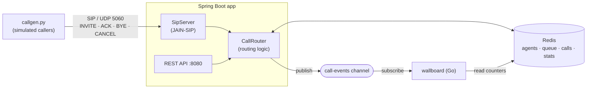

# SIP Call Router

A mini contact-center call router (ACD). Customers call in over **SIP**, a **Java / Spring Boot** service
routes each call to the longest-idle agent, and calls queue in **Redis** when everyone is busy.
A **Python** call generator simulates callers, and a **Go** wallboard shows the live numbers.

Signaling only: no audio (RTP), which keeps the project small while exercising the real SIP call flow.

## How it works



| Situation | What the caller gets |
|---|---|
| An agent is free | `100 Trying` → `180 Ringing` → `200 OK` with `X-Agent-Id` |
| All agents busy | `182 Queued` with `X-Queue-Position`, then `180` + `200 OK` when an agent frees up |
| Queue full (`max-queue-size`) | `486 Busy Here` |
| Caller hangs up while queued | `CANCEL` → `200 OK` + `487 Request Terminated` |
| Call ends | `BYE` → `200 OK`; the agent goes back to the free pool and takes the next queued call |

### Redis data model

| Key | Type | Purpose |
|---|---|---|
| `agents:all` | SET | every agent id |
| `agents:available` | ZSET | free agents scored by idle-since time. `ZPOPMIN` = longest-idle agent, atomically |
| `agent:{id}` | HASH | `status`, `currentCallId` |
| `queue:calls` | LIST | waiting calls, FIFO (`RPUSH` / `LPOP`) |
| `calls:active` | SET | connected calls |
| `call:{callId}` | HASH | from, to, state, agentId, wait time; gets a 1h TTL once finished |
| `stats` | HASH | counters via `HINCRBY`, plus `waitMsTotal` (average wait = `waitMsTotal / connected`) |
| `call-events` | PUB/SUB | JSON event per call state change |

## Run it

Requirements: Java 21 (`JAVA_HOME` must point at it), Docker (for Redis), Python 3.10+.
Maven is optional: the Maven wrapper (`./mvnw`, or `mvnw.cmd` on Windows) downloads it.

```bash
docker compose up -d redis          # Redis on :6379
./mvnw spring-boot:run              # SIP on udp/5060, REST on :8080
```

In a second terminal, place some calls (3 agents are seeded: alice, bob, carol; queue size 5):

```bash
python3 simulator/callgen.py --calls 10 --talk 3 8 --patience 15
```

In a third terminal, the live wallboard (built and run in Docker, so Go is not needed):

```bash
docker compose run --rm wallboard
```

It shows calls waiting, calls active, free agents, average wait, each agent's status and the latest events.
It only subscribes to `call-events` and reads Redis; it never calls the Java service.

## Demo script

```bash
redis-cli MONITOR                    # watch every Redis command live
redis-cli SUBSCRIBE call-events      # or watch the event stream

curl -s localhost:8080/api/agents | jq
curl -s localhost:8080/api/queue | jq
curl -s localhost:8080/api/calls/active | jq
curl -s localhost:8080/api/stats | jq

# take an agent offline / bring one back (picks up the next queued call immediately)
curl -X POST localhost:8080/api/agents/bob/status -H 'Content-Type: application/json' -d '{"status":"OFFLINE"}'
curl -X POST localhost:8080/api/agents/bob/status -H 'Content-Type: application/json' -d '{"status":"AVAILABLE"}'

# add a new agent
curl -X POST localhost:8080/api/agents/dave
```

## Project layout

```
src/main/java/io/github/atelci/callrouter/
  sip/SipServer.java          SIP UAS: maps SIP requests to routing calls and decisions to SIP responses
  call/CallRouter.java        routing logic (connect / queue / reject / drain queue)
  agent/AgentService.java     agent state in Redis
  api/                        REST endpoints
  config/                     properties, Redis pub/sub listener
src/main/resources/redis/     Lua script that pairs a queued call with a free agent atomically
simulator/callgen.py          SIP caller simulator (standard library only)
wallboard/main.go             Go terminal wallboard fed by the call-events channel (go-redis)
```

## Design notes

- **Routing is SIP-agnostic.** `CallRouter` talks to the signaling layer through the `CallSignaling` interface,
  so it can be tested with a fake and the SIP stack could be swapped.
- **State in Redis, transactions in memory.** Open SIP INVITE transactions are live protocol objects, so they
  stay in the JVM; everything about the call itself is in Redis.
- **Serving the queue is atomic.** When an agent frees up, "pop the oldest call + claim the longest-idle agent +
  mark it busy" runs as one Redis Lua script (`src/main/resources/redis/claim-next-call.lua`). With separate
  `LPOP` and `ZPOPMIN` calls, a second instance could take the last agent in between: the popped call would
  then have to be pushed back (losing its place, or lost entirely if the instance crashed in between).
- **Still not fully multi-instance.** The new-call path (claim an agent, else check the queue size and enqueue)
  is several commands, so router methods stay `synchronized`. Two instances could briefly over-fill the queue
  by one. The fix is the same idea (one more script), plus sticky SIP routing so a call's BYE and CANCEL reach
  the instance holding its INVITE transaction.

## Built with AI assistance

<!-- Fill this in as you go: which tools, what you prompted, what you had to fix by hand. -->

- Scaffolded with Claude (project structure, SIP handler, Redis model, simulator)
- Continued in Claude Code: first `mvn verify` and the end-to-end run with `callgen.py`.
  The scaffold compiled and ran on the first try; no Java changes were needed. Things that came up:
  - The machine's default `java` was 1.8, so the build needs `JAVA_HOME` pointing at a JDK 21.
  - Added the Maven wrapper (`mvnw`, `mvnw.cmd`).
  - A 10-caller run against 3 agents and queue size 5 gave 3 connected right away, 5 queued (FIFO) and then
    connected as agents freed up, and 2 rejected with 486. A short `--patience` run checked CANCEL -> 487.
- Integration tests for `CallRouter` (`CallRouterTest`): real Redis via Testcontainers (`redis:7-alpine`) and a
  fake `CallSignaling`, wired by hand without a Spring context so the SIP stack never binds UDP 5060. Covers
  longest-idle agent first, FIFO queue, queue full -> rejected, BYE frees the agent and drains the queue, CANCEL
  removes a queued call. Fixed by hand: the Testcontainers version Spring Boot 3.5.6 manages (1.21.3) talks
  Docker API 1.32, which Docker Engine 29 refuses ("Could not find a valid Docker environment"); pinning
  `testcontainers.version` to 1.21.4 fixed it. The tests passed on the first run after that.
- Atomic queue draining: `CallRouter.drainQueue()` now calls `claim-next-call.lua` instead of separate
  `LPOP` + `ZPOPMIN` (+ push back on failure). Three new tests cover drain order, an empty queue, and two router
  instances draining one queue from 8 threads (every call gets exactly one agent, no agent is used twice). The
  `callgen.py` demo gives the same results as before. No fixes by hand were needed.
- Go wallboard (`wallboard/`): subscribes to `call-events` and redraws from Redis on every event and once a
  second. Go was not installed on the dev machine, so it is built in the `golang:1.24-alpine` image and run via a
  `wallboard` compose profile. Added a `waitMsTotal` counter to `stats` so the average wait comes from Redis rather
  than from whatever events the wallboard happened to see. Checked against a live run: the wallboard's average wait
  (3.2s) matched `callgen.py`'s summary. One change made after watching it: the counters row was labelled "Today"
  but `stats` is all-time, so it now says "Totals".

## Next steps

- Media: SDP offer/answer and RTP bridging to the agent's phone
- Skills-based routing (language, product) with one ZSET per skill
- Live wallboard over Server-Sent Events fed by the `call-events` channel
- Hand overflow calls to an AI voice agent instead of rejecting them
