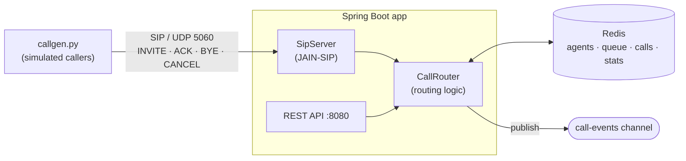

# SIP Call Router

A mini contact-center call router (ACD). Customers call in over **SIP**, a **Java / Spring Boot** service
routes each call to the longest-idle agent, and calls queue in **Redis** when everyone is busy.
A **Python** call generator simulates callers.

Signaling only: no audio (RTP), which keeps the project small while exercising the real SIP call flow.

## How it works



| Situation | What the caller gets |
|---|---|
| An agent is free | `100 Trying` → `180 Ringing` → `200 OK` with `X-Agent-Id` |
| All agents busy | `182 Queued` with `X-Queue-Position`, then `180` + `200 OK` when an agent frees up |
| Queue full (`max-queue-size`) | `486 Busy Here` |
| Caller hangs up while queued | `CANCEL` → `200 OK` + `487 Request Terminated` |
| Call ends | `BYE` → `200 OK`; the agent goes back to the free pool and takes the next queued call |

### Redis data model

| Key | Type | Purpose |
|---|---|---|
| `agents:all` | SET | every agent id |
| `agents:available` | ZSET | free agents scored by idle-since time. `ZPOPMIN` = longest-idle agent, atomically |
| `agent:{id}` | HASH | `status`, `currentCallId` |
| `queue:calls` | LIST | waiting calls, FIFO (`RPUSH` / `LPOP`) |
| `calls:active` | SET | connected calls |
| `call:{callId}` | HASH | from, to, state, agentId, wait time; gets a 1h TTL once finished |
| `stats` | HASH | counters via `HINCRBY` |
| `call-events` | PUB/SUB | JSON event per call state change |

## Run it

Requirements: Java 21 (`JAVA_HOME` must point at it), Docker (for Redis), Python 3.10+.
Maven is optional: the Maven wrapper (`./mvnw`, or `mvnw.cmd` on Windows) downloads it.

```bash
docker compose up -d redis          # Redis on :6379
./mvnw spring-boot:run              # SIP on udp/5060, REST on :8080
```

In a second terminal, place some calls (3 agents are seeded: alice, bob, carol; queue size 5):

```bash
python3 simulator/callgen.py --calls 10 --talk 3 8 --patience 15
```

## Demo script

```bash
redis-cli MONITOR                    # watch every Redis command live
redis-cli SUBSCRIBE call-events      # or watch the event stream

curl -s localhost:8080/api/agents | jq
curl -s localhost:8080/api/queue | jq
curl -s localhost:8080/api/calls/active | jq
curl -s localhost:8080/api/stats | jq

# take an agent offline / bring one back (picks up the next queued call immediately)
curl -X POST localhost:8080/api/agents/bob/status -H 'Content-Type: application/json' -d '{"status":"OFFLINE"}'
curl -X POST localhost:8080/api/agents/bob/status -H 'Content-Type: application/json' -d '{"status":"AVAILABLE"}'

# add a new agent
curl -X POST localhost:8080/api/agents/dave
```

## Project layout

```
src/main/java/io/github/atelci/callrouter/
  sip/SipServer.java          SIP UAS: maps SIP requests to routing calls and decisions to SIP responses
  call/CallRouter.java        routing logic (connect / queue / reject / drain queue)
  agent/AgentService.java     agent state in Redis
  api/                        REST endpoints
  config/                     properties, Redis pub/sub listener
simulator/callgen.py          SIP caller simulator (standard library only)
```

## Design notes

- **Routing is SIP-agnostic.** `CallRouter` talks to the signaling layer through the `CallSignaling` interface,
  so it can be tested with a fake and the SIP stack could be swapped.
- **State in Redis, transactions in memory.** Open SIP INVITE transactions are live protocol objects, so they
  stay in the JVM; everything about the call itself is in Redis.
- **Single instance for now.** Router methods are `synchronized`. Running several instances would need the
  "pop call + claim agent" step as one Redis Lua script, plus sticky SIP routing.

## Built with AI assistance

<!-- Fill this in as you go: which tools, what you prompted, what you had to fix by hand. -->

- Scaffolded with Claude (project structure, SIP handler, Redis model, simulator)
- Continued in Claude Code: first `mvn verify` and the end-to-end run with `callgen.py`.
  The scaffold compiled and ran on the first try; no Java changes were needed. Things that came up:
  - The machine's default `java` was 1.8, so the build needs `JAVA_HOME` pointing at a JDK 21.
  - Added the Maven wrapper (`mvnw`, `mvnw.cmd`).
  - A 10-caller run against 3 agents and queue size 5 gave 3 connected right away, 5 queued (FIFO) and then
    connected as agents freed up, and 2 rejected with 486. A short `--patience` run checked CANCEL -> 487.
  - `mvn verify` has no tests to run yet; Testcontainers tests for `CallRouter` come next.

## Next steps

- Media: SDP offer/answer and RTP bridging to the agent's phone
- Skills-based routing (language, product) with one ZSET per skill
- Live wallboard over Server-Sent Events fed by the `call-events` channel
- Hand overflow calls to an AI voice agent instead of rejecting them
