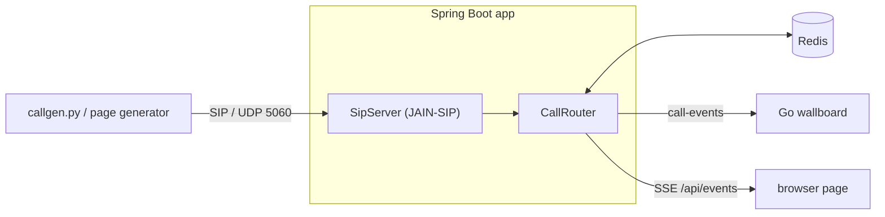

# SIP Call Router

A mini contact-center call router (ACD). Callers dial in over **SIP**, a **Java / Spring Boot** service routes
each call to the longest-idle agent with the right skill, and calls queue in **Redis** when everyone suitable is
busy. A **Python** script simulates callers and a **Go** wallboard shows live numbers. Signaling only, no audio.



## Routing

The dialed SIP user is the skill: `sip:billing@router` waits for a `billing` agent; `sip:support@router` (or any
unknown name) goes to any agent. Demo agents: alice `[en, billing]`, bob `[en]`, carol `[de, billing]`.

| Situation | Caller gets |
|---|---|
| Matching agent free | `180 Ringing` → `200 OK` with `X-Agent-Id` |
| All matching agents busy | `182 Queued` with `X-Queue-Position`, then `200 OK` |
| Queue full | `486 Busy Here` |
| Caller hangs up while queued | `CANCEL` → `487 Request Terminated` |
| Call ends (`BYE`) | Agent frees up and takes the longest-waiting call it can handle |

## Run it

Needs Java 21, Docker and Python 3.10+.

```bash
docker compose up -d redis
./mvnw spring-boot:run                                   # SIP udp/5060, web :8080
python3 simulator/callgen.py --calls 10 --talk 3 8       # add --skills en de billing support
docker compose run --rm wallboard                        # live Go wallboard
```

Or everything in Docker: `docker compose --profile full up -d --build`.

Open **http://localhost:8080/** to start calls from the page and watch live SIP ladder diagrams, queues and the
app log. `render.yaml` deploys the same thing to Render's free tier (only HTTP is public there, so use the page's
generator rather than `callgen.py`).

## Design notes

- **Routing is SIP-agnostic.** `CallRouter` talks to SIP through a `CallSignaling` interface, so tests use a fake.
- **State in Redis, transactions in memory.** Live SIP INVITE transactions stay in the JVM; all call and agent
  state is in Redis (keys documented in `RedisKeys.java`).
- **Skills are just more pools.** A free agent sits in one ZSET per skill, scored by idle-since time, so
  "longest-idle German speaker" is a `ZPOPMIN` on `agents:available:de`.
- **Claiming is atomic.** Popping a queued call and claiming an agent from all its pools runs as one Lua script
  (`claim-agent.lua`), so two instances can never grab the same agent.
- **Tests** run `CallRouter` against real Redis via Testcontainers: `./mvnw verify`.
